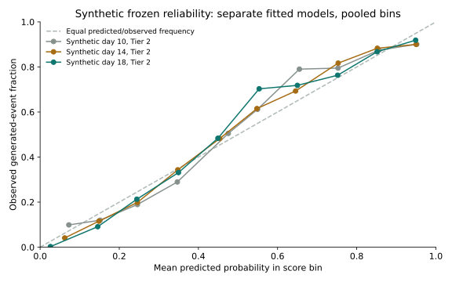
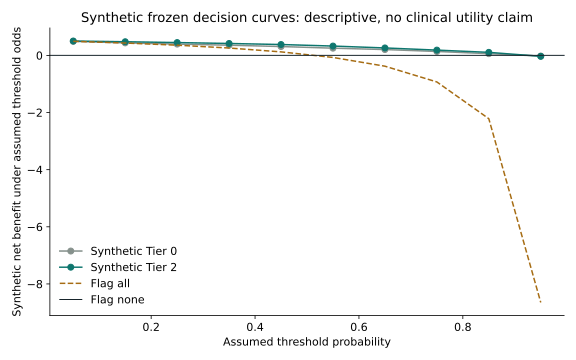
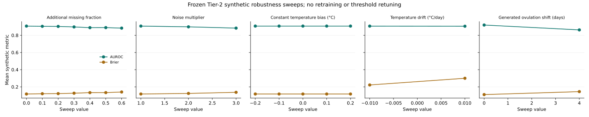

# CycleTwin_VIT

**Team: CycleTwin**  
**College: VIT**  
Team leader: Kushagra Gupta. Registration and contact details are submitted by the human leader on Unstop.

> Synthetic research prototype. Not for diagnosis, contraception or conception planning. No clinical validity, hormone inference or real-world accuracy is claimed.

## Problem and use case

CycleTwin studies whether calendar and wearable-style signals can flag a generated cycle with ovulation after day 21 or no generated ovulation. It does not diagnose PMOS. The current population mixes synthetic PMOS and non-PMOS archetypes.

## What is built

- One persisted fitted prediction path for the benchmark, cohort, patient and Kushi views. src/inference.py returns the probability, validation threshold, fallback and exact additive feature evidence.
- Static EHR-lite and dynamic observations share a feature builder. EHR-lite is **oracle-adjacent, simulator-internal evidence**, because it includes a label-generating latent. No actual hormone assay is used.
- Explicit safety inputs fail closed. An abstaining view suppresses personal scores, intervals, explanations, sandbox outputs and alerts.
- Ovulation day uses a separate calendar/temperature heuristic. Its interval is conditional on an ovulatory cycle and remains an illustration without measured frozen coverage.
- A separate reproductive/metabolic simulator illustrates assumed dynamics. It does not affect the fitted score. The input-editing sandbox does not estimate causal treatment effects.
- Apple Health-shaped XML parsing is implemented. Imported XML does not become a scored patient. Upload temporary files are deleted after parsing.
- Meet Kushi is a fictional story selected by generator truth and declared seeds, never model output. Later scenario seeds are independent replays, not real longitudinal measurements.

## Run

```sh
python3 -m venv .venv
. .venv/bin/activate
python -m pip install -r requirements.txt
streamlit run app.py
```

The selected fitted model artifacts are included. `make all` regenerates synthetic development evaluation, models, claims, README tables and figures. `python -m unittest discover -s tests -v` runs the suite, including AppTest.

## Stack and pinned dependencies

Python, NumPy, scikit-learn, pandas, Streamlit and Altair. The classifier uses median imputation, standardization, logistic regression and validation Platt calibration. Richer tiers fall back to calendar when validation does not support Brier improvement. Validation F1 selects operating thresholds.

- numpy==2.0.2
- pandas==2.3.3
- streamlit==1.50.0
- altair==5.5.0
- scikit-learn==1.6.1
- scipy==1.13.1
- joblib==1.5.3
- threadpoolctl==3.7.0

## Synthetic development results

All values in this document are generated from docs/claims.json by scripts/build_claims.py. These seeds are development evidence because earlier versions repeatedly evaluated them. They are not an untouched final test. Patient-level splits within each run prevent patient-ID overlap.

The predeclared temperature tier at day 18 has mean synthetic AUROC 0.905584 and Brier 0.119091. The same snapshot contains 3,240 test cycles across the development seeds. These are descriptive seed means, not pooled AUROC or clinical accuracy.

<!-- RESULTS:START -->
| Synthetic seed | Day | Requested / retained tier | AUROC [patient CI] | Standard AP [patient CI] | Brier [patient CI] | Day MAE [patient CI] | Validation threshold | Sensitivity | PPV |
|---|---|---|---|---|---|---|---|---|---|
| 97 | 10 | 0 / 0 | 0.843 [0.813, 0.871] | 0.848 [0.808, 0.885] | 0.161 [0.145, 0.176] | 5.134 [4.849, 5.446] | 0.479778 | 0.836 | 0.743 |
| 97 | 10 | 1 / 0 | 0.843 [0.812, 0.870] | 0.848 [0.806, 0.885] | 0.161 [0.145, 0.176] | 5.134 [4.862, 5.436] | 0.479778 | 0.836 | 0.743 |
| 97 | 10 | 2 / 0 | 0.843 [0.815, 0.868] | 0.848 [0.808, 0.883] | 0.161 [0.146, 0.175] | 5.134 [4.843, 5.460] | 0.479778 | 0.836 | 0.743 |
| 97 | 10 | 3 / 0 | 0.843 [0.812, 0.869] | 0.848 [0.807, 0.882] | 0.161 [0.146, 0.176] | 5.134 [4.847, 5.407] | 0.479778 | 0.836 | 0.743 |
| 97 | 14 | 0 / 0 | 0.843 [0.816, 0.870] | 0.848 [0.811, 0.884] | 0.161 [0.146, 0.175] | 5.275 [5.000, 5.572] | 0.479778 | 0.836 | 0.743 |
| 97 | 14 | 1 / 0 | 0.843 [0.813, 0.872] | 0.848 [0.805, 0.882] | 0.161 [0.145, 0.176] | 5.275 [5.021, 5.530] | 0.479778 | 0.836 | 0.743 |
| 97 | 14 | 2 / 2 | 0.862 [0.833, 0.886] | 0.863 [0.819, 0.897] | 0.150 [0.136, 0.166] | 6.788 [6.410, 7.154] | 0.404429 | 0.863 | 0.764 |
| 97 | 14 | 3 / 0 | 0.843 [0.815, 0.871] | 0.848 [0.810, 0.883] | 0.161 [0.145, 0.175] | 5.275 [5.023, 5.564] | 0.479778 | 0.836 | 0.743 |
| 97 | 18 | 0 / 0 | 0.843 [0.814, 0.871] | 0.848 [0.805, 0.883] | 0.161 [0.145, 0.176] | 5.584 [5.341, 5.859] | 0.479778 | 0.836 | 0.743 |
| 97 | 18 | 1 / 0 | 0.843 [0.812, 0.871] | 0.848 [0.808, 0.884] | 0.161 [0.145, 0.176] | 5.584 [5.311, 5.859] | 0.479778 | 0.836 | 0.743 |
| 97 | 18 | 2 / 2 | 0.909 [0.886, 0.929] | 0.888 [0.851, 0.921] | 0.116 [0.103, 0.130] | 5.137 [4.851, 5.451] | 0.312124 | 0.949 | 0.796 |
| 97 | 18 | 3 / 3 | 0.909 [0.885, 0.930] | 0.889 [0.848, 0.924] | 0.116 [0.101, 0.130] | 5.137 [4.864, 5.453] | 0.339045 | 0.935 | 0.796 |
| 101 | 10 | 0 / 0 | 0.837 [0.805, 0.867] | 0.820 [0.771, 0.861] | 0.164 [0.149, 0.180] | 4.945 [4.650, 5.262] | 0.472111 | 0.834 | 0.729 |
| 101 | 10 | 1 / 0 | 0.837 [0.804, 0.865] | 0.820 [0.770, 0.857] | 0.164 [0.150, 0.180] | 4.945 [4.639, 5.251] | 0.472111 | 0.834 | 0.729 |
| 101 | 10 | 2 / 0 | 0.837 [0.805, 0.864] | 0.820 [0.770, 0.860] | 0.164 [0.149, 0.179] | 4.945 [4.627, 5.267] | 0.472111 | 0.834 | 0.729 |
| 101 | 10 | 3 / 0 | 0.837 [0.805, 0.866] | 0.820 [0.775, 0.862] | 0.164 [0.149, 0.180] | 4.945 [4.622, 5.273] | 0.472111 | 0.834 | 0.729 |
| 101 | 14 | 0 / 0 | 0.837 [0.805, 0.865] | 0.820 [0.771, 0.861] | 0.164 [0.149, 0.179] | 5.087 [4.805, 5.410] | 0.472111 | 0.834 | 0.729 |
| 101 | 14 | 1 / 0 | 0.837 [0.806, 0.864] | 0.820 [0.771, 0.859] | 0.164 [0.150, 0.179] | 5.087 [4.770, 5.370] | 0.472111 | 0.834 | 0.729 |
| 101 | 14 | 2 / 0 | 0.837 [0.806, 0.865] | 0.820 [0.773, 0.859] | 0.164 [0.150, 0.179] | 5.087 [4.793, 5.383] | 0.472111 | 0.834 | 0.729 |
| 101 | 14 | 3 / 0 | 0.837 [0.803, 0.866] | 0.820 [0.772, 0.861] | 0.164 [0.148, 0.181] | 5.087 [4.788, 5.413] | 0.472111 | 0.834 | 0.729 |
| 101 | 18 | 0 / 0 | 0.837 [0.805, 0.864] | 0.820 [0.776, 0.862] | 0.164 [0.149, 0.180] | 5.395 [5.106, 5.655] | 0.472111 | 0.834 | 0.729 |
| 101 | 18 | 1 / 1 | 0.840 [0.810, 0.866] | 0.832 [0.788, 0.868] | 0.163 [0.149, 0.178] | 5.395 [5.126, 5.658] | 0.446349 | 0.828 | 0.747 |
| 101 | 18 | 2 / 2 | 0.900 [0.875, 0.921] | 0.878 [0.842, 0.911] | 0.124 [0.110, 0.138] | 5.504 [5.190, 5.818] | 0.424825 | 0.918 | 0.785 |
| 101 | 18 | 3 / 3 | 0.904 [0.883, 0.925] | 0.888 [0.852, 0.918] | 0.123 [0.108, 0.136] | 5.504 [5.207, 5.847] | 0.414048 | 0.920 | 0.783 |
| 103 | 10 | 0 / 0 | 0.833 [0.801, 0.862] | 0.809 [0.760, 0.851] | 0.164 [0.148, 0.181] | 4.934 [4.651, 5.238] | 0.359280 | 0.905 | 0.692 |
| 103 | 10 | 1 / 0 | 0.833 [0.802, 0.861] | 0.809 [0.763, 0.851] | 0.164 [0.150, 0.180] | 4.934 [4.628, 5.249] | 0.359280 | 0.905 | 0.692 |
| 103 | 10 | 2 / 0 | 0.833 [0.799, 0.863] | 0.809 [0.762, 0.850] | 0.164 [0.148, 0.181] | 4.934 [4.652, 5.236] | 0.359280 | 0.905 | 0.692 |
| 103 | 10 | 3 / 0 | 0.833 [0.800, 0.864] | 0.809 [0.765, 0.850] | 0.164 [0.148, 0.181] | 4.934 [4.640, 5.215] | 0.359280 | 0.905 | 0.692 |
| 103 | 14 | 0 / 0 | 0.833 [0.800, 0.861] | 0.809 [0.766, 0.849] | 0.164 [0.149, 0.181] | 5.034 [4.783, 5.314] | 0.359280 | 0.905 | 0.692 |
| 103 | 14 | 1 / 0 | 0.833 [0.801, 0.862] | 0.809 [0.763, 0.851] | 0.164 [0.149, 0.180] | 5.034 [4.777, 5.317] | 0.359280 | 0.905 | 0.692 |
| 103 | 14 | 2 / 2 | 0.852 [0.822, 0.878] | 0.830 [0.789, 0.870] | 0.156 [0.140, 0.172] | 6.332 [5.977, 6.661] | 0.394068 | 0.856 | 0.748 |
| 103 | 14 | 3 / 3 | 0.850 [0.820, 0.877] | 0.829 [0.786, 0.868] | 0.157 [0.142, 0.174] | 6.332 [5.961, 6.718] | 0.411717 | 0.846 | 0.758 |
| 103 | 18 | 0 / 0 | 0.833 [0.802, 0.863] | 0.809 [0.765, 0.848] | 0.164 [0.148, 0.180] | 5.338 [5.094, 5.606] | 0.359280 | 0.905 | 0.692 |
| 103 | 18 | 1 / 0 | 0.833 [0.800, 0.862] | 0.809 [0.761, 0.852] | 0.164 [0.148, 0.181] | 5.338 [5.080, 5.597] | 0.359280 | 0.905 | 0.692 |
| 103 | 18 | 2 / 2 | 0.907 [0.883, 0.926] | 0.874 [0.835, 0.908] | 0.118 [0.104, 0.132] | 5.161 [4.852, 5.457] | 0.395215 | 0.912 | 0.797 |
| 103 | 18 | 3 / 3 | 0.906 [0.882, 0.927] | 0.875 [0.837, 0.910] | 0.118 [0.103, 0.134] | 5.161 [4.876, 5.454] | 0.460962 | 0.879 | 0.808 |
<!-- RESULTS:END -->

Saved intervals use patient-cluster resampling. Standard average precision now groups score ties correctly. The earlier custom AUPRC and its interval are retained as legacy fields; the raw frozen result stays immutable. Day MAE excludes absent-ovulation cycles. Forecast-day distance to the reporting cutoff is not actual event lead time. The main benchmark does not evaluate sequential alert-policy effectiveness or safety-gate coverage. Full exact values remain in results.json and model cards.

## Frozen synthetic evaluation

The frozen-v1 tag records the executable protocol before the reserved seeds were generated. The once-only runner saved model artifacts, held-out predictions and a result hash. Follow-up reporting does not retune its thresholds.

| Frozen synthetic seed | Day | Tier | AUROC | Brier | n |
|---|---|---|---|---|---|
| 7001 | 10 | 0 | 0.835360 | 0.166318 | 1080 |
| 7001 | 10 | 1 | 0.835360 | 0.166318 | 1080 |
| 7001 | 10 | 2 | 0.835360 | 0.166318 | 1080 |
| 7001 | 10 | 3 | 0.835360 | 0.166318 | 1080 |
| 7001 | 14 | 0 | 0.835360 | 0.166318 | 1080 |
| 7001 | 14 | 1 | 0.835360 | 0.166318 | 1080 |
| 7001 | 14 | 2 | 0.850268 | 0.158191 | 1080 |
| 7001 | 14 | 3 | 0.835360 | 0.166318 | 1080 |
| 7001 | 18 | 0 | 0.835360 | 0.166318 | 1080 |
| 7001 | 18 | 1 | 0.835360 | 0.166318 | 1080 |
| 7001 | 18 | 2 | 0.903931 | 0.117682 | 1080 |
| 7001 | 18 | 3 | 0.903370 | 0.118611 | 1080 |
| 7003 | 10 | 0 | 0.848835 | 0.157982 | 1080 |
| 7003 | 10 | 1 | 0.848835 | 0.157982 | 1080 |
| 7003 | 10 | 2 | 0.848835 | 0.157982 | 1080 |
| 7003 | 10 | 3 | 0.848835 | 0.157982 | 1080 |
| 7003 | 14 | 0 | 0.848835 | 0.157982 | 1080 |
| 7003 | 14 | 1 | 0.848835 | 0.157982 | 1080 |
| 7003 | 14 | 2 | 0.863090 | 0.150130 | 1080 |
| 7003 | 14 | 3 | 0.861405 | 0.151141 | 1080 |
| 7003 | 18 | 0 | 0.848835 | 0.157982 | 1080 |
| 7003 | 18 | 1 | 0.848835 | 0.157982 | 1080 |
| 7003 | 18 | 2 | 0.910948 | 0.115142 | 1080 |
| 7003 | 18 | 3 | 0.909476 | 0.116652 | 1080 |
| 7007 | 10 | 0 | 0.832518 | 0.166535 | 1080 |
| 7007 | 10 | 1 | 0.832518 | 0.166535 | 1080 |
| 7007 | 10 | 2 | 0.832518 | 0.166535 | 1080 |
| 7007 | 10 | 3 | 0.832518 | 0.166535 | 1080 |
| 7007 | 14 | 0 | 0.832518 | 0.166535 | 1080 |
| 7007 | 14 | 1 | 0.832518 | 0.166535 | 1080 |
| 7007 | 14 | 2 | 0.850331 | 0.158000 | 1080 |
| 7007 | 14 | 3 | 0.853743 | 0.156655 | 1080 |
| 7007 | 18 | 0 | 0.832518 | 0.166535 | 1080 |
| 7007 | 18 | 1 | 0.832518 | 0.166535 | 1080 |
| 7007 | 18 | 2 | 0.907047 | 0.117776 | 1080 |
| 7007 | 18 | 3 | 0.909205 | 0.117042 | 1080 |

## Calibration and subgroup reporting

| Frozen synthetic seed | Day | Tier | Subset | n | AUROC | Standard AP | ECE | Recall [patient CI] |
|---|---|---|---|---|---|---|---|---|
| 7001 | 18 | 2 | all | 1080 | 0.903931 | 0.888087 | 0.045927 | 0.931459 [0.906739, 0.955403] |
| 7001 | 18 | 2 | PMOS-only | 480 | 0.867001 | 0.920701 | 0.092014 | 0.946429 [0.923542, 0.971098] |
| 7001 | 18 | 2 | safety-gate-passing | 684 | 0.874673 | 0.890492 | 0.065566 | 0.934783 [0.905191, 0.959291] |
| 7003 | 18 | 2 | all | 1080 | 0.910948 | 0.882411 | 0.017047 | 0.915162 [0.892920, 0.936244] |
| 7003 | 18 | 2 | PMOS-only | 480 | 0.873162 | 0.909165 | 0.067775 | 0.932551 [0.903575, 0.957628] |
| 7003 | 18 | 2 | safety-gate-passing | 695 | 0.900964 | 0.897495 | 0.034724 | 0.922892 [0.894472, 0.946705] |
| 7007 | 18 | 2 | all | 1080 | 0.907047 | 0.876740 | 0.054869 | 0.913357 [0.886119, 0.936132] |
| 7007 | 18 | 2 | PMOS-only | 480 | 0.862685 | 0.901668 | 0.089885 | 0.939024 [0.915247, 0.962214] |
| 7007 | 18 | 2 | safety-gate-passing | 683 | 0.872243 | 0.870334 | 0.060424 | 0.927681 [0.899743, 0.950999] |

Full per-day/tier/archetype AUROC and recall intervals, reliability bins, ECE, diagnostic calibration slope/intercept and decision curves are in results_reporting.json. Diagnostic calibration regressions never feed predictions. Synthetic decision curves assume threshold odds and do not establish clinical utility.





## Frozen sequential alert policy

The frozen policy evaluates the first safe threshold crossing at days 10, 14 and 18, with at most one alert per cycle; it uses saved frozen scores without retraining or retuning. Tier 2 produced 1,634 alerts across 3,240 generated cycles: precision 0.730110; missed generated events 484/1,677 (0.288611); false alerts 1.483785 per synthetic patient-year. Median generated-event lead time was 17.000000 days among 790 true-positive cycles with a generated ovulation day. These are simulator outcomes, not clinical alert rates. Full rows are in results/alert_policy_frozen_rows.csv.

## Frozen synthetic robustness extension

The fixed day-18 Tier-2 models and thresholds were tested under the predeclared synthetic sweeps. With 60% additional forced missing temperature readings, mean AUROC was 0.883694, Brier 0.140207, and safety withholding 1.000000. At +0.01°C/day device drift, mean AUROC was 0.905727 and Brier 0.300007. A +4-day generated timing shift on independent synthetic cohorts gave mean AUROC 0.862897 and Brier 0.144600. These are simulator sensitivity analyses, not validation of a wearable device or clinical workflow. Full values: results_robustness_frozen.json and results/robustness_frozen.csv.



## Frozen synthetic timing-posterior check

A train-only discrete Bayesian posterior used a calendar/static prior and pre/post-event temperature, RHR and HRV likelihoods to estimate generated timing or absence. Its mean synthetic Brier was 0.098486, versus 0.116867 for the frozen fitted logistic score; difference -0.018380, patient-cluster 95% CI [-0.022494, -0.014070]. Status: noninferior synthetic check; still separate interpretation layer. It remains a separately reported interpretation layer and does not replace the score, threshold, safety gate or alert policy. Full artifact: results_bayesian_twin_frozen.json and models/twin/.

## Evidence and limitations

- [Complete implementation audit](docs/audit_2026-10-20/CycleTwin_full_audit.md), a historical snapshot before the corrections.
- [After-audit change log](docs/CHANGELOG_AFTER_AUDIT.md) and [generated claims](docs/claims.json).
- [Evaluation plan](docs/eval_plan.md), [assumptions](docs/assumptions.md), [jury Q&A](docs/jury_qa.md).
- Synthetic labels and signals share assumptions. No clinical, external or prospective real-person validation exists.
- Old generator start dates can overlap; logged-start error is not fully propagated through real-time feature alignment.
- No validated treatment model, hormone inference, contraception guidance or conception-planning support exists.
- Frozen evaluation is complete. Robustness, ops measurements and a Bayesian state estimator remain separate follow-up gates until their evidence is generated.

## Deliverables

- [Architecture PDF](deliverables/CycleTwin_architecture.pdf) and [editable PPTX](deliverables/CycleTwin_architecture.pptx).
- [Pitch PDF](deliverables/CycleTwin_pitch_deck.pdf) and [editable PPTX](deliverables/CycleTwin_pitch_deck.pptx).
- [Submission checklist](SUBMISSION_CHECKLIST.md).
- Required video: human recording/upload deferred by the user. **No video link exists yet.** Scripts are in docs/video_script_20min.md and docs/video_script_3min.md. The competition requires a minimum 20-minute recording.

Existing screenshots are historical UI captures and do not represent a new visual-verification claim.

## Licence and disclosure

Code uses the [MIT License](LICENSE). All project datasets are synthetic. Published medical references provide context and are not training data. AI coding assistants helped build this project. No LLM runs in the prediction or explanation path.
