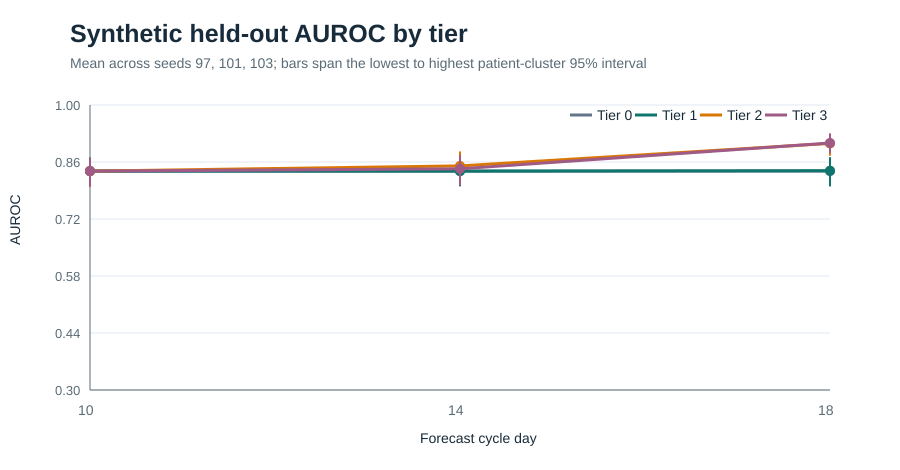
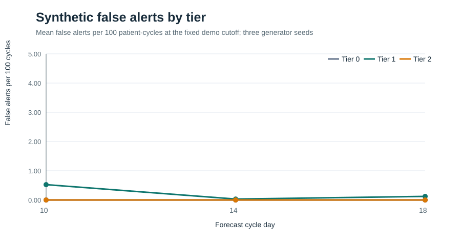
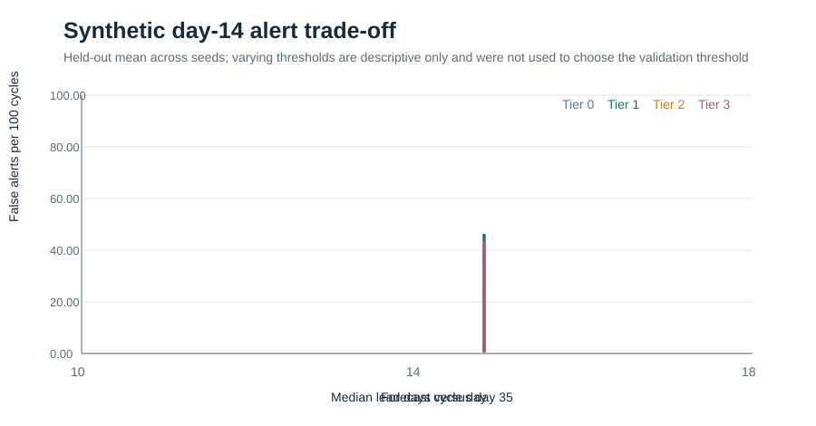

# CycleTwin_VIT

**CycleTwin: synthetic cycle forecasting demo**  
Solo participant: Kushagra Gupta, full-time student, VIT.

> Decision-support research prototype only. Not for diagnosis, contraception or conception planning.

CycleTwin explores prospective per-cycle forecasting of simulated oligo-anovulation, with an ovulation-day estimate and an explicit alert budget. It is not retrospective ovulation confirmation or case/control identification.

## Design thesis and implemented scope

The design thesis is: prospective per-cycle forecasting with an ovulation-day interval, abstention and a one-alert budget; one twin with reproductive and metabolic axes connected through a shared insulin-resistance latent, including reverse luteal-to-glucose coupling; sensor tiers from period logs through wearables, nightly temperature, CGM and EHR; and an Apple Health-native input contract. These are design directions, not differentiation claims. This build implements a simplified coupled twin in the dashboard, synthetic period and wearable tiers, a limited Apple Health XML parser, explicit abstention guards, split-conformal helpers, and a one-alert selection rule. The twin is not calibrated and is not used in the evaluated E1 predictor. Adaptive conformal updates and evaluated CGM forecasts are not implemented. The benchmark fits logistic-regression tier models on train patients, calibrates and chooses thresholds on validation patients, then evaluates held-out patients. Tier 0 uses prior logged cycle lengths; tier 1 adds RHR, HRV, steps and sleep; tier 2 adds nightly temperature; tier 3 adds synthetic EHR-lite. Tier 3 is oracle-adjacent because it includes simulator variables used to generate the label, so its numbers are simulator-internal checks only.

This repository uses synthetic data only. It contains no personal exports or clinical dataset. Metrics are internal checks against a simulator and do not establish clinical validity.

## Run

```sh
python3 -m venv .venv && . .venv/bin/activate
pip install -r requirements.txt
make all
make demo-apple
```

`make all` generates synthetic patients, runs the prespecified patient-held-out evaluation, and writes `results.json`. `make demo-apple` writes a synthetic Apple Health-shaped XML export, parses it locally, and displays a small Streamlit dashboard.

## Model and scope

A stochastic generator creates synthetic patients and noisy cycle observations. Fitted logistic-regression classifiers supply the evaluated prospective risk estimate, with Platt calibration and threshold selection on validation patients. A temperature coverline heuristic estimates ovulation day, with a fixed fallback when no rise is visible. The dashboard also runs a simplified reproductive/metabolic simulator coupled through a shared synthetic latent. This is not an EKF or a clinical hormone model and is not used in the benchmark metrics. The dashboard can display synthetic CGM and marginal split-conformal ranges calibrated on a separate synthetic cohort; these are illustrative and are not evaluated in the benchmark results. See [assumptions](docs/assumptions.md) and the [evaluation plan](docs/eval_plan.md).

## Results

<!-- RESULTS:START -->

| Seed | Forecast day | Tier | AUROC (95% patient-cluster CI) | AUPRC (95% patient-cluster CI) | Ovulation-day MAE (95% CI) | Brier | Validation threshold | Sensitivity | PPV | False alerts/100 cycles |
|---:|---:|---:|---:|---:|---:|---:|---:|---:|---:|---:|
| 97 | 10 | 0 | 0.850 (0.822–0.877) | 0.862 (0.821–0.896) | 6.17 (5.80–6.59) | 0.157 | 0.475 | 0.852 | 0.753 | 14.722 |
| 97 | 10 | 1 | 0.852 (0.823–0.878) | 0.863 (0.820–0.898) | 6.17 (5.79–6.59) | 0.157 | 0.482 | 0.847 | 0.754 | 14.537 |
| 97 | 10 | 2 | 0.848 (0.820–0.873) | 0.859 (0.820–0.892) | 6.17 (5.81–6.59) | 0.157 | 0.476 | 0.840 | 0.754 | 14.444 |
| 97 | 10 | 3 | 0.848 (0.818–0.875) | 0.859 (0.818–0.893) | 6.17 (5.80–6.56) | 0.158 | 0.455 | 0.826 | 0.784 | 11.944 |
| 97 | 14 | 0 | 0.850 (0.824–0.876) | 0.862 (0.825–0.897) | 6.79 (6.43–7.13) | 0.157 | 0.475 | 0.852 | 0.753 | 14.722 |
| 97 | 14 | 1 | 0.851 (0.822–0.878) | 0.862 (0.821–0.895) | 6.79 (6.40–7.14) | 0.157 | 0.461 | 0.852 | 0.750 | 14.907 |
| 97 | 14 | 2 | 0.867 (0.838–0.890) | 0.866 (0.820–0.899) | 6.79 (6.41–7.15) | 0.148 | 0.459 | 0.831 | 0.797 | 11.111 |
| 97 | 14 | 3 | 0.866 (0.839–0.891) | 0.865 (0.825–0.899) | 6.79 (6.41–7.15) | 0.148 | 0.445 | 0.826 | 0.791 | 11.481 |
| 97 | 18 | 0 | 0.850 (0.822–0.876) | 0.862 (0.818–0.895) | 8.58 (7.96–9.13) | 0.157 | 0.475 | 0.852 | 0.753 | 14.722 |
| 97 | 18 | 1 | 0.853 (0.823–0.881) | 0.863 (0.823–0.897) | 8.58 (8.00–9.16) | 0.155 | 0.472 | 0.808 | 0.782 | 11.852 |
| 97 | 18 | 2 | 0.912 (0.890–0.932) | 0.888 (0.850–0.921) | 5.14 (4.85–5.45) | 0.113 | 0.394 | 0.919 | 0.819 | 10.648 |
| 97 | 18 | 3 | 0.912 (0.888–0.933) | 0.888 (0.846–0.923) | 5.14 (4.86–5.45) | 0.114 | 0.341 | 0.935 | 0.805 | 11.944 |
| 101 | 10 | 0 | 0.842 (0.810–0.871) | 0.834 (0.786–0.875) | 5.85 (5.49–6.24) | 0.161 | 0.430 | 0.856 | 0.729 | 16.111 |
| 101 | 10 | 1 | 0.841 (0.809–0.868) | 0.833 (0.785–0.872) | 5.85 (5.46–6.26) | 0.161 | 0.456 | 0.843 | 0.737 | 15.278 |
| 101 | 10 | 2 | 0.842 (0.811–0.868) | 0.834 (0.784–0.872) | 5.85 (5.48–6.27) | 0.161 | 0.440 | 0.854 | 0.732 | 15.833 |
| 101 | 10 | 3 | 0.847 (0.815–0.875) | 0.845 (0.800–0.884) | 5.85 (5.47–6.30) | 0.159 | 0.375 | 0.872 | 0.719 | 17.315 |
| 101 | 14 | 0 | 0.842 (0.811–0.869) | 0.834 (0.785–0.875) | 6.62 (6.26–6.99) | 0.161 | 0.430 | 0.856 | 0.729 | 16.111 |
| 101 | 14 | 1 | 0.840 (0.811–0.868) | 0.833 (0.783–0.872) | 6.62 (6.26–6.98) | 0.161 | 0.468 | 0.818 | 0.742 | 14.444 |
| 101 | 14 | 2 | 0.855 (0.825–0.881) | 0.843 (0.797–0.880) | 6.62 (6.26–6.97) | 0.155 | 0.363 | 0.896 | 0.730 | 16.852 |
| 101 | 14 | 3 | 0.858 (0.825–0.886) | 0.853 (0.806–0.891) | 6.62 (6.26–6.97) | 0.153 | 0.384 | 0.878 | 0.752 | 14.722 |
| 101 | 18 | 0 | 0.842 (0.810–0.869) | 0.834 (0.789–0.874) | 8.64 (8.08–9.15) | 0.161 | 0.430 | 0.856 | 0.729 | 16.111 |
| 101 | 18 | 1 | 0.844 (0.815–0.871) | 0.836 (0.792–0.875) | 8.64 (8.09–9.24) | 0.160 | 0.361 | 0.892 | 0.708 | 18.704 |
| 101 | 18 | 2 | 0.904 (0.879–0.924) | 0.881 (0.844–0.914) | 5.50 (5.19–5.82) | 0.122 | 0.438 | 0.909 | 0.802 | 11.389 |
| 101 | 18 | 3 | 0.907 (0.885–0.928) | 0.890 (0.853–0.920) | 5.50 (5.21–5.85) | 0.121 | 0.394 | 0.920 | 0.787 | 12.593 |
| 103 | 10 | 0 | 0.839 (0.807–0.868) | 0.828 (0.778–0.865) | 5.59 (5.28–5.92) | 0.161 | 0.429 | 0.879 | 0.718 | 17.500 |
| 103 | 10 | 1 | 0.840 (0.809–0.867) | 0.825 (0.779–0.865) | 5.59 (5.26–5.90) | 0.161 | 0.412 | 0.881 | 0.718 | 17.500 |
| 103 | 10 | 2 | 0.840 (0.805–0.867) | 0.824 (0.777–0.863) | 5.59 (5.28–5.92) | 0.161 | 0.412 | 0.879 | 0.718 | 17.500 |
| 103 | 10 | 3 | 0.839 (0.805–0.868) | 0.825 (0.779–0.864) | 5.59 (5.27–5.90) | 0.162 | 0.379 | 0.879 | 0.717 | 17.593 |
| 103 | 14 | 0 | 0.839 (0.808–0.866) | 0.828 (0.782–0.863) | 6.33 (5.99–6.69) | 0.161 | 0.429 | 0.879 | 0.718 | 17.500 |
| 103 | 14 | 1 | 0.840 (0.807–0.868) | 0.826 (0.779–0.867) | 6.33 (5.96–6.70) | 0.161 | 0.388 | 0.885 | 0.715 | 17.870 |
| 103 | 14 | 2 | 0.857 (0.826–0.884) | 0.836 (0.795–0.875) | 6.33 (5.98–6.66) | 0.153 | 0.388 | 0.863 | 0.752 | 14.444 |
| 103 | 14 | 3 | 0.856 (0.826–0.882) | 0.837 (0.793–0.876) | 6.33 (5.96–6.72) | 0.154 | 0.400 | 0.859 | 0.761 | 13.704 |
| 103 | 18 | 0 | 0.839 (0.809–0.868) | 0.828 (0.781–0.864) | 8.50 (7.91–9.13) | 0.161 | 0.429 | 0.879 | 0.718 | 17.500 |
| 103 | 18 | 1 | 0.844 (0.813–0.871) | 0.829 (0.783–0.871) | 8.50 (7.87–9.10) | 0.159 | 0.418 | 0.859 | 0.737 | 15.556 |
| 103 | 18 | 2 | 0.908 (0.884–0.927) | 0.876 (0.838–0.910) | 5.16 (4.85–5.46) | 0.117 | 0.501 | 0.865 | 0.814 | 10.000 |
| 103 | 18 | 3 | 0.908 (0.884–0.928) | 0.878 (0.841–0.913) | 5.16 (4.88–5.45) | 0.117 | 0.424 | 0.898 | 0.805 | 11.019 |

All three fresh generator seeds are shown. Models are fitted on train patients, Platt-calibrated and threshold-selected on validation patients, then evaluated once on held-out patients.
<!-- RESULTS:END -->







These figures aggregate the three fresh synthetic seeds; error bars span the lowest to highest seed-specific patient-cluster 95% interval. They are internal simulator checks, not clinical performance estimates.

## Data and privacy

Synthetic data only. The Apple Health adapter is a schema-compatibility smoke test, n=1 synthetic export, and clinically validates nothing. A personal export must be a consenting adult's own file, processed locally, never committed, and never used for training, tuning, or thresholds. The demo processes locally and stores only nightly aggregates. See [privacy notes](docs/privacy.md).

## Architecture and reporting

See [architecture](docs/architecture.md), [related work](docs/related_work.md), and [TRIPOD+AI notes](docs/tripod_ai.md).

## Pitch artifacts

- [Architecture diagram (PPTX)](deliverables/CycleTwin_VIT_architecture_v4.pptx) · [PDF](deliverables/CycleTwin_VIT_architecture_v4.pdf)
- [Pitch deck (PPTX)](deliverables/CycleTwin_VIT_pitch_deck_v8.pptx) · [PDF](deliverables/CycleTwin_VIT_pitch_deck_v8.pdf)
- [Jury Q&A](docs/jury_qa.md)

AI coding assistants helped build this project. All generated metrics describe synthetic data only.

Stack: Python, NumPy, Streamlit, and the Python standard library. Code is released under the MIT License.
